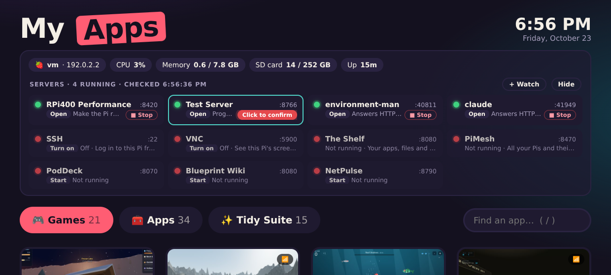

# My Apps for the Raspberry Pi 400

A clickable menu of all my apps and games for the Pi 400, with server lights at the top.

- **Games**, **Apps** and the **Tidy Suite** as big tiles (arrow keys, Enter, `/` to search)
- **Server lights**: this Pi's temperature, CPU, memory, SD card and power, plus a green/red light
  for every server (SSH, VNC, The Shelf, PiMesh, PodDeck, Blueprint Wiki, NetPulse, ...)
- **Stop buttons**: shut down any running web server one at a time (click, then confirm)
- **RPi400 Performance**: make the Pi run as fast as it can

## Set up
Copy the folder to the Pi and run `Set Up My Apps.sh` once. It adds a My Apps icon to the Desktop
and menu, icons for the apps that run as small programs, and starts the server-lights helper
(`status/pi-status.py`, which only listens on 127.0.0.1).

See `READ ME FIRST.txt` for every app.
