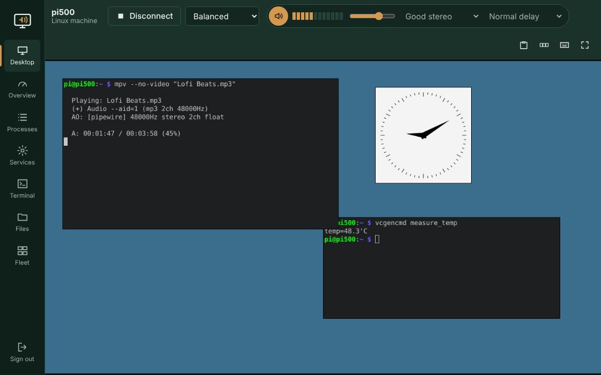

# PiPortal

See **and hear** your Raspberry Pi from any web browser — PC, phone or tablet — plus everything you need to manage it.
Works on the **Pi 5, Pi 500, Pi 4 and Pi 400** running Raspberry Pi OS Bookworm or Trixie.



Regular VNC has no sound. PiPortal streams the Pi's desktop *and* whatever it's playing (YouTube, games, music, system sounds) to your browser.

## What's in it

| Section | What it does |
|---|---|
| **Desktop** | The Pi's screen in your browser. Mouse, keyboard, clipboard, Ctrl+Alt+Del, full screen, on-screen keyboard for phones. Three picture settings (Sharp / Balanced / Fast for Wi-Fi). |
| **Sound** | Speaker button streams the Pi's audio. Live level meter, your own volume, three quality levels (Hi-fi 48 kHz stereo, Good 32 kHz stereo, Low-data mono) and three delay settings. |
| **Overview** | CPU per core with history, temperature, fan speed (Pi 5/500), memory, storage, network speed, power-supply and throttling warnings, Pi speaker volume and mute, Restart and Shut down. |
| **Processes** | Live list sorted by CPU. End any process (Shift-click to force). |
| **Services** | Start, stop, restart systemd services and read their logs. |
| **Terminal** | A full shell in the browser. |
| **Files** | Browse, upload (drag and drop), download, rename, delete, new folder. |
| **Fleet** | Add your other Pis running PiPortal; see which are up and jump between them. |

## Install (on each Pi)

In a terminal on the Pi:

```bash
git clone https://github.com/hardwaremack-prog/piportal.git
cd piportal
./install.sh            # or ./install.sh --https
```

To update later: `cd piportal && git pull && ./install.sh` (your password is kept).

It installs what it needs, asks you to pick a password, and starts PiPortal now and on every boot. At the end it prints the address, e.g. `http://192.168.1.50:6090` or `http://pi500.local:6090`.

**The Pi must be logged in to its desktop** (Raspberry Pi OS auto-login is on by default) — that's where the screen and sound come from. On a Pi with no monitor, set a resolution under `sudo raspi-config` → Display Options so there's a desktop to show.

## Desktop icon

`start-piportal.sh` is what a Desktop icon should run: the first time it runs the installer, after that it just opens PiPortal. `Open PiPortal.html` finds PiPortal on this Pi and jumps to it (it's what the My Apps menu tile opens).

## Tips

- **iPhone/iPad:** tap the speaker button to start sound (Apple requires a tap). If you hear nothing, flip the ring/silent switch off.
- **Choppy sound on Wi-Fi?** Pick "Smooth on Wi-Fi" in the delay menu, or "Low data (mono)".
- **Pi 4 / 400** start on the "Fast (Wi-Fi)" picture setting since their video encoding is slower.
- **Mute the Pi's own speakers** in Overview if you only want sound on the remote device — streaming keeps working.
- **HTTPS:** `./install.sh --https` makes a self-signed certificate. Your browser will warn the first time; accept it once.

## How it works

- A small Python (aiohttp) server on port **6090**.
- **Picture:** starts its own private VNC server bound to `127.0.0.1:5910` — `wayvnc` on the Wayland desktop (Bookworm/Trixie default), or `x11vnc` on X11 — and relays it to the built-in noVNC client. Your normal VNC on port 5900 is untouched.
- **Sound:** `parec` records the default speaker's monitor through PipeWire and sends raw 16-bit audio in 20 ms chunks over a WebSocket; the browser schedules it with Web Audio. No extra codecs, almost no CPU.
- Login uses a salted PBKDF2 password and a session cookie; 8 wrong tries locks that address out for 10 minutes.

## Files

- App: `~/.local/share/piportal/`
- Settings and password: `~/.config/piportal/config.json`
- Change password: `python3 ~/.local/share/piportal/server.py --set-password` then `sudo systemctl restart piportal`
- Logs: `journalctl -u piportal -f`
- Remove: `~/.local/share/piportal/uninstall.sh`

## Security note

PiPortal gives full control of the Pi (terminal, files, services) to anyone with the password. Keep it on your home network; don't port-forward it to the internet.

Bundles noVNC (MPL-2.0) and xterm.js (MIT); licenses in `web/vendor/`.
